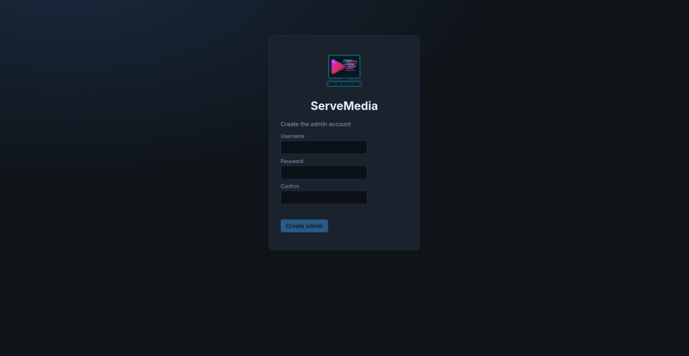
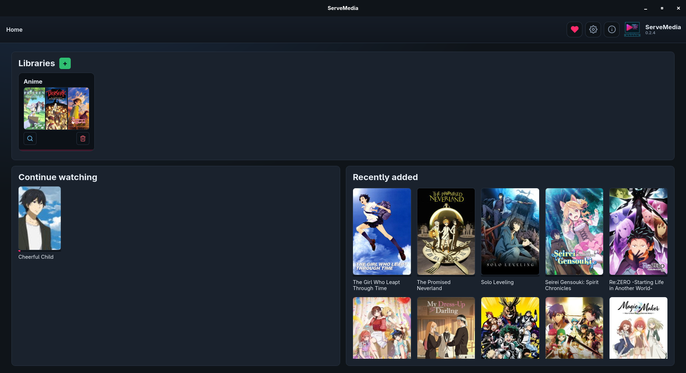
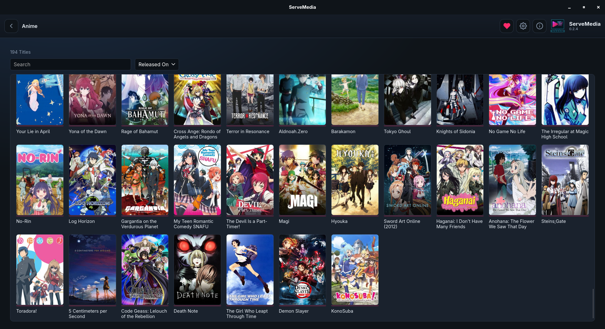
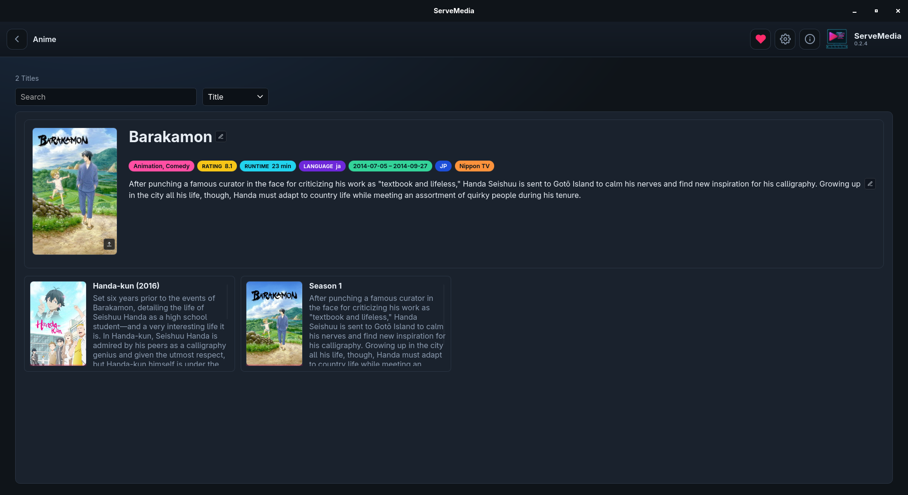
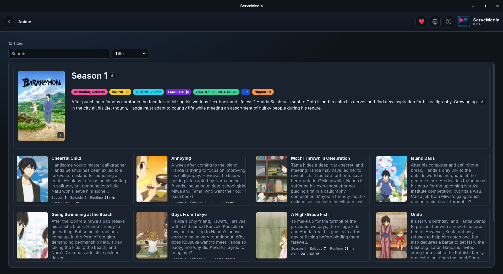
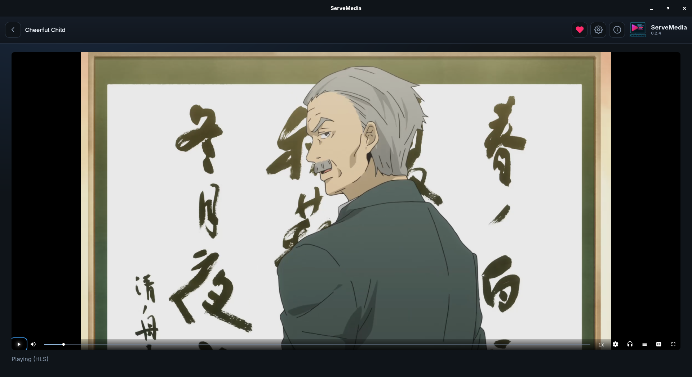
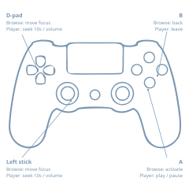
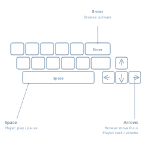

<p align="center">
  
</p>

<h1 align="center">ServeMedia</h1>

<p align="justified">
<b>ServeMedia</b> is <it>The Self-Hosted Media-Center for Linux</it>. It is built around a core module called MatchMedia which acts as a statistical engine responsible for directory hierarchy discovery of media libraries, title extraction and grouping, metadata search-and-fetch from providers like TVMaze, statistically scoring and ranking candidates and mapping them to the appropriate files and folder hierarchies. <b>ServeMedia</b> is built to be lightweight, minimal and concise, yet feature-complete for a self hosted media center. <b>ServeMedia</b> can be both: a standalone desktop application with a desktop entry and a webkit wrapped gui on a single device, and a media server which can serve a server-side-rendered frontend over the local network. Compatible files play directly. Other files are transcoded to HLS, on the GPU when the driver check succeeds.
</p>

> [!WARNING]
> ServeMedia is currently in Beta, users might face some breaking bugs or incomplete functionality.
> Work is being done to remedy any problems, please feel free to open up [issues on github](https://github.com/AlyShmahell/ServeMedia/issues )

## Platform Compatibility Matrix

| Operating system | Architecture | Tier |
|---|---|---|
| Linux (glibc) | x86-64 | Tier 1 |
| Linux (musl) | x86-64 | Tier 2 |
| Linux (glibc) | AArch64 | Tier 3 |
| Linux (musl) | AArch64 | Tier 3 |

* Tier 1: A release is published and tested.
* Tier 2: A release is published but not tested.
* Tier 3: The source may or may not compile, and the binary may or may not work.
* Tier 4: The source will not compile and/or the binary will not work.

## Requirements

> [!IMPORTANT]
> Fedora was used as a reference; Therefore, package names may be different on different glibc or musl Linux systems like Debian or Alpine.

#### Required

> [!NOTE]
> Package names below are for the Tier 1 **Server and AppImage**. 
> **Flatpak** brings its own copies of these libraries.

- to perform ffprobe, extract stills, and ffmpeg transcode
  - `libva libdrm`

#### Recommended
- for GPU/iGPU encode
  - on AMD: 
    - on glibc: `mesa-dri-drivers mesa-va-drivers-freeworld`
    - on musl: `mesa-dri-drivers mesa-va-gallium`
  - on Intel: `intel-media-driver`

#### Optional
> [!NOTE]
> Package names below are for the Tier 1 **Server and AppImage**. 
> **Flatpak** brings its own copies of these libraries.
- For a **Desktop Window (with `--webkit`)**
  - using WebKitGTK 6.0: `glib2 gtk4 webkitgtk6.0`
  - using WebKitGTK 4.1: `glib2 gtk3 webkit2gtk4.1`
- For opening a browser on a start **(by omitting `--webkit`)**, when a display is set
  - `xdg-utils glib2`

## Install

### As a Desktop Application

It can be installed in one of two ways: 
- **Flatpak**
  <a href='https://flathub.org/apps/eu.alyshmahell.ServeMedia'>
      
  </a>
  - Sandbox can already read `/media`, `/mnt`, `/run/media`, `~/Videos`, and `~/Music`. 
  - Extra media library directories:
    ```bash
    flatpak override --user --filesystem=/path/to/library eu.alyshmahell.ServeMedia
    ```

- **AppImage**
  - download either from this repo's latest [Release](https://github.com/AlyShmahell/ServeMedia/releases/latest)


### As a Server Application

* glibc:

```bash
curl -fL https://github.com/AlyShmahell/ServeMedia/releases/latest/download/servemedia-linux-amd64-glibc.tar.gz \
  | tar -xz -C "$HOME" --strip-components=1 servemedia/.local
```

* musl:

```bash
curl -fL https://github.com/AlyShmahell/ServeMedia/releases/latest/download/servemedia-linux-amd64-musl.tar.gz \
  | tar -xz -C "$HOME" --strip-components=1 servemedia/.local
```

##### How to Run
```bash
servemedia --host <address> --port <number> 
```
- `--host` sets the bind address. Unset listens on every interface.
- `--port` sets the port. Unset uses `7676` and picks another port only if that default is busy. An explicit `--port` exits if it cannot bind.
- Other machines on the LAN use `http://<lan-ip>:<port>`. The firewall has to allow that port from the LAN.
- With a display, the browser opens. A second start checks `/healthz` and exits. After a tab has connected, closing it shuts the server down about 60 seconds later.
- Without `--webkit`, the first visit is `/register` and creates the **admin**; after that `/register` is gone. The installed desktop entry passes `--webkit` and skips this.

## How to Use

Start ServeMedia, add a library, open a title, and play.

Create the admin account **(only for the Server release, not the Flatpak or AppImage)**

<p align="center">
  
</p>

Home with libraries and recently added titles.

<p align="center">
  
</p>

Anime library poster grid.

<p align="center">
  
</p>

Title page with plot and seasons.

<p align="center">
  
</p>

Season page with episode stills.

<p align="center">
  
</p>

Browser playback.

<p align="center">
  
</p>

## Controls

Arrow keys or a gamepad move focus on Home, libraries, titles, and Settings. The focus outline appears while using arrows or a pad, not for mouse-only use.

<p align="center">
  
</p>
<p align="center">
  
</p>

If the pad does nothing in **Firefox from Flathub**, grant host udev, then fully quit Firefox and reopen ServeMedia:

```bash
flatpak override --user --filesystem=/run/udev:ro org.mozilla.firefox
```

Same grant works in Flatseal. Other Flatpak browsers: use that app’s ID. Distro Firefox usually needs nothing extra.

## Important Paths

Default media library roots: `/mnt`, `/media`, `$XDG_VIDEOS_DIR`, `$XDG_MUSIC_DIR`.

| | Desktop (Flatpak) | Desktop (AppImage) | Server |
|--|---------|----------|----------|
| Binary | User install `~/.local/share/flatpak/app/eu.alyshmahell.ServeMedia/current/active/files/bin/servemedia` |  | `~/.local/bin/servemedia` |
| Share **(`$XDG_DATA_HOME`)**| `~/.var/app/eu.alyshmahell.ServeMedia/data/servemedia` | `~/.local/share/servemedia` | `~/.local/share/servemedia` |
| Cache **(`$XDG_CACHE_HOME`)**| `~/.var/app/eu.alyshmahell.ServeMedia/cache/servemedia` | `~/.cache/servemedia` | `~/.cache/servemedia` |


## Development Notes: 
[docs/architecture.md](docs/architecture.md).
