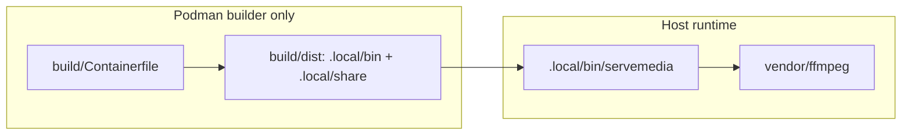

# Architecture

ServeMedia is the self-hosted media server for Linux (scan, metadata, playback). A Podman **builder** writes `build/dist/` as an XDG tree; runtime is the **host binary** (`./build/run`), not a container. Metadata lookup is first-party [MatchMedia](https://github.com/AlyShmahell/MatchMedia), linked into the `servemedia` binary. Third-party assets live under `{payload}/vendor/`. Payload is `SERVEMEDIA_ROOT` or `$XDG_DATA_HOME/servemedia`.

Go module: `github.com/alyshmahell/servemedia/src`.



## Layout

| Path | Role |
|------|------|
| `src/cmd` | HTTP server (`-config`, `--host`, `--port`) |
| `src/internal` | config, db, fetch (numbered `files[]` ingest, prune, reattach, dissociate), media (probe/HLS/ffmpeg), matchmedia client |
| `src/web` | go:embed templates + first-party static |
| `src/share/config` | Seed `default.yaml` (version + `media.path`) → `build/dist/.local/share/servemedia/config` |
| `src/share/vendor.yaml` | Builder-only asset and codec URLs; not loaded by the binary |
| `src/share/applications` | `servemedia.desktop` staged to `.local/share/applications` |
| `build/` | Podman dist builder (`Containerfile`, compose, host `run`, `build`) |
| `flatpak/` | TTY `build` online/offline, manifest, AppStream, `pins/`, wrapper (`eu.alyshmahell.ServeMedia`, GNOME 51) |
| `build/cache/` | ffmpeg bins + LICENSE; Flatpak SDK/Platform under `cache/flatpak` |
| `{payload}/config` | Seed YAML (`-config` default `{payload}/config/default.yaml`) |
| `{payload}/public` | First-party static in dist (templates stay embedded) |
| `$XDG_DATA_HOME/servemedia` | SQLite store, backups, overlay `config/overlay.yaml` (Flatpak: sandbox XDG) |
| `$XDG_CACHE_HOME/servemedia/transcode` | HLS cache |
| `{payload}/vendor` | Third-party only: htmx, video.js, hls.js, ffmpeg (+ licenses) |
| `tests/` | Podman unit + Playwright smoke against bind-mounted dist |

`vendor/` is third-party only. MatchMedia is the Go module `github.com/alyshmahell/matchmedia`, pinned in [`flatpak/pins/servemedia-go-sources.yml`](../flatpak/pins/servemedia-go-sources.yml).

## Rules

- Podman with `podman-compose` (or `podman compose`)
- Do not install or run Go, Node, or Playwright on the host for ServeMedia tests
- Never `go test` / `npm test` / `npx playwright` on the host for this repo’s automated path
- Never Docker as the test runner (`./tests/run` refuses Docker-only environments)
- App data: `$XDG_DATA_HOME/servemedia` (or `build/cache/xdg` for `./build/run`); tests use a compose XDG volume

## Dist

[`build/Containerfile`](../build/Containerfile) is a one-shot **builder**. Host driver: [`./build/run`](../build/run). Image helper: [`build/build`](../build/build) (`vendor` at image build, `stage` at container start).

| Item | Value |
|------|--------|
| Go image | `docker.io/library/golang:1.26-bookworm` |
| Build | glibc: `CGO_ENABLED=0 GOOS=linux GOARCH=amd64 go build` on `golang:1.26-bookworm`. musl: `CGO_ENABLED=1` on `golang:1.26-alpine` (`build/Containerfile.servemedia-musl`), cached at `build/cache/servemedia-musl`. The binary opens the site in the browser (`xdg-open`; `SERVEMEDIA_NO_BROWSER=1` skips). |
| App version SoT | `version` in `src/share/config/default.yaml` |
| MatchMedia | Go module in the `servemedia` binary; Flatpak pins it with the other modules |
| Dist wipe | `build/dist` wiped at container start (`.gitkeep` kept) |
| `build/cache` | never deleted |

Stage tree:

| Dest | Source |
|------|--------|
| `.local/bin/servemedia` | Go `./cmd`; opens the site in the browser |
| `.local/share/servemedia/config/` | `src/share/config` |
| `.local/share/servemedia/public/` | first-party static |
| `.local/share/applications/` | desktop |
| dist root + share `LICENSE` | repo `LICENSE` |
| `.local/share/servemedia/vendor/` | third-party JS at image build |
| `.local/share/servemedia/vendor/ffmpeg` | glibc pair from `build/cache/ffmpeg` in the glibc dist. The musl archive replaces that directory with `build/cache/ffmpeg-musl` |

ffmpeg: codecs (x264, x265, Opus, dav1d, SVT-AV1, libvpx, LAME, libvpl) static; `libva` / `libdrm` dynamic; NVENC headers only. URLs live in `src/share/vendor.yaml`. The glibc pair is compiled in the Debian builder and shipped only in the glibc archive. The musl pair is the same recipe in [`build/Containerfile.musl`](../build/Containerfile.musl) (Alpine), cached at `build/cache/ffmpeg-musl`, and shipped only in the musl archive at `vendor/ffmpeg/`. Delete `build/cache/ffmpeg`, `build/cache/ffmpeg-musl`, or `build/cache/servemedia-musl` to force a rebuild after bumping them. The binary does not download vendor files.

`./build/run` menu:

| Choice | What |
|--------|------|
| **run** | copy `build/dist/.local` → `build/cache/xdg`, exec with `HOME` there (fails if `.local/bin/servemedia` missing) |
| **(re)build & run** | rebuild dist, then run |
| **(re)build & package** | glibc and musl tarballs + AppImages (not Flatpak); refuses a dist tree missing vendor files |

## Packages

| Archive | ffmpeg | Notes |
|---------|--------|-------|
| `servemedia-linux-amd64-glibc.tar.gz` | glibc `vendor/ffmpeg/{ffmpeg,ffprobe}` (static codecs, host libva) | root `servemedia/` + `LICENSE`; glibc `.local/bin/servemedia` + share trees |
| `servemedia-linux-amd64-glibc.AppImage` | same ELFs | packs that tarball (quick-sharun / sharun / uruntime). quick-sharun deploys the server binary only. `libva` and `libdrm` are deleted from the image. Host `libwebkitgtk-6.0` with GTK 4 when installed, otherwise `libwebkit2gtk-4.1` with GTK 3, the same as a local `--webkit` run; `SERVEMEDIA_ROOT` = bundled share; data under `$XDG_DATA_HOME/servemedia`; needs `/dev/dri` for GPU |
| `servemedia-linux-amd64-musl.tar.gz` | musl `vendor/ffmpeg/{ffmpeg,ffprobe}` | same share tree; `.local/bin/servemedia` is the Alpine cgo binary (`ld-musl`, no `libc.so.6`) |
| `servemedia-linux-amd64-musl.AppImage` | same ELFs | static musl `AppRun` execs the untouched musl binary with `--webkit`. quick-sharun only packs the AppDir, so the ELF keeps `ld-musl`. Host musl `libva` / WebKit; `libva` and `libdrm` are not shipped |
| `servemedia-linux-amd64.flatpak` | none; `org.freedesktop.Platform.ffmpeg-full` (26.08); WebKitGTK 6.0 from the runtime when present, otherwise WebKitGTK 4.1 | `./flatpak/build`; runtime `org.gnome.Platform//51`; app id `eu.alyshmahell.ServeMedia`; wrapper `SERVEMEDIA_ROOT=/app` and `--webkit`; data `~/.var/app/eu.alyshmahell.ServeMedia/data/servemedia/` |

Sideload:

```bash
flatpak install --user build/package/servemedia-linux-amd64.flatpak
flatpak run eu.alyshmahell.ServeMedia
```

`./flatpak/build` (needs host `podman` + `flatpak`; runtimes in `build/cache/flatpak`):

| Mode | Source |
|------|--------|
| **online** | latest GitHub ServeMedia release; regen Go pins from tags; `modules.txt` as URL+sha256 |
| **offline** | local `src/share/config/default.yaml` (version SoT) and `src/share/vendor.yaml` (asset URLs); regen from local `src/` (`type: dir`); pin `modules.txt` stays `path:` |

Each mode: resync → regen → lint → build → package → install. Manifest: [`flatpak/eu.alyshmahell.ServeMedia.yml`](../flatpak/eu.alyshmahell.ServeMedia.yml). Wrapper: [`flatpak/servemedia-wrapper`](../flatpak/servemedia-wrapper). Pins: [`flatpak/pins/`](../flatpak/pins/). The MatchMedia Go module is pinned with the other modules in `servemedia-go-sources.yml`.

Sandbox reads `/media`, `/mnt`, `/run/media`, `~/Videos`, `~/Music`; other paths need `flatpak override --filesystem=…`.

## HTTP

ServeMedia listens on a TCP address from `--host` and `--port`. Unset `--host` is every interface. Unset `--port` is `7676`. If that bind fails, ServeMedia listens again on port `0` and the kernel chooses the port. An explicit `--port` that cannot bind stops the process. `--webkit` forces `127.0.0.1` and port `0` and opens a window on that loopback URL, using host `libwebkitgtk-6.0` with GTK 4 when that library is installed and otherwise `libwebkit2gtk-4.1` with GTK 3. A successful window does not also open a browser. If the window cannot be created, the error is logged, the system browser opens, and the server keeps running until a signal or the watchdog. A second `--webkit` start that cannot open a window opens the browser and exits, leaving the existing server up. Without `--webkit`, the browser opens `http://127.0.0.1:<port>` when `DISPLAY` or `WAYLAND_DISPLAY` is set (`SERVEMEDIA_NO_BROWSER=1` skips that open). Other machines use `http://<lan-ip>:<port>`. The chosen port is written to `port` and the loopback URL to `http.url` in `$XDG_RUNTIME_DIR/servemedia`, or under `$XDG_STATE_HOME/servemedia` when `XDG_RUNTIME_DIR` is unset. A second start reads `http.url` and `GET`s `/healthz` on that loopback URL. A live server is opened and this process exits. A missing file or a failed check starts a new server. Shutdown deletes `http.url` and `port`. MatchMedia runs inside that process.

| Method | Path | Role |
|--------|------|------|
| GET | `/` | home |
| GET | `/healthz` | process liveness |
| GET | `/about` | version + `{payload}/LICENSE` |
| GET/POST | `/settings/integrations` | webhooks (per user) and MatchMedia secrets (admin) |
| POST | `/play/{kind}/{id}/session` | direct or HLS playback session |
| GET | `/stream/{kind}/{id}` | byte-range original |
| GET | `/hls/{job}/…` | transcode playlist/segments |
| GET | `/static/vendor/*` | `{payload}/vendor` (htmx, video.js, hls.js) |
| GET | `/static/*` | embedded first-party static |

Playback: **video.js** + **hls.js** on the video.js tech. Session, progress, prefs, VTT, chapters, prev/next stay on ServeMedia APIs. Site focus is first-party `controls.js`; on the player page, keyboard arrows stay with video.js.

Idle HLS jobs are cancelled a few minutes after last segment access. The process is not stopped when the browser is idle.

## Data

| Item | Where |
|------|--------|
| Writable data | `$XDG_DATA_HOME/servemedia` (`SERVEMEDIA_HOME` override) |
| Overlay | `config/overlay.yaml` stores settings (backup, webhooks, transcode knobs, startup scan, watchdog). Internal paths in that file are ignored. `media.path` there still overrides the seed. |
| Transcode cache | `$XDG_CACHE_HOME/servemedia/transcode` |
| Media root | `SERVEMEDIA_MEDIA_PATH` / overlay `media.path` (comma-separated paths jailed separately, one picker tree; `$HOME`, `$XDG_VIDEOS_DIR`, `$XDG_MUSIC_DIR` expand) |
| ffmpeg/ffprobe | `{payload}/vendor/ffmpeg/` pair shipped with that archive. A tree that also has `musl/` uses it when host `libva` needs `libc.musl` (`SERVEMEDIA_FFMPEG` override). Flatpak: `ffmpeg` on `PATH` when that tree is absent |

## Libraries and scan

Libraries have a name and folder only (no movie/TV/anime type). Local, Rescan, and Changes all go through MatchMedia grouping. ServeMedia does not re-walk the tree to classify extras or kinds. Structural filename parsers (SxxEyy, year, `1x02`) stay for display and persist naming. Extras/kinds live in MatchMedia overlay (`group.extras` / `group.kinds`). ServeMedia overlay has no `scan.layout`. Fetch remaining work: numbered `files[]` ingest, prune, reattach, dissociate.

| Mode | MatchMedia | Dialog default | `require_episode_nfo` | Overwrite |
|------|------------|----------------|----------------------|-----------|
| Local (`nfo`) | `POST /v1/scan` `mode=nfo` | — | omit (MM default false) | — |
| Rescan | `mode=rescan` | — | omit | — |
| Changes | `mode=changes` | when MM is ready | omit (MM default true) | forced off |

When MatchMedia is down, all three options are disabled (no walker fallback). Entry scan keeps Dissociate. Persist-beside-media NFO/art stays in ServeMedia when checked. User title, plot, and poster edits write the NFO and art beside the media and store that absolute path in SQLite. Stills and nested-movie sidecars never overwrite an existing show `poster.jpg`. Poster/still file changes persist only when Save is clicked in the poster dialog.

| Apply input | Rule |
|-------------|------|
| `job.kind` | `movie` / `show` |
| extras | `role=extras` only → season 0 on parent (`catalog_for` is not extras) |
| `kind=movie` under a show | child movie card beside seasons (matched or unmatched); not season 0 |
| Specials | `role=extras`, or `files[]` with `season: "0"` / unnumbered files **on the show job** |
| `files[]` | every current video on that title (not a delta); empty or unnumbered skips episode ingest |
| `job.path` | grouped child (folder or movie file) |
| per-item | `POST /v1/ingest` `[{title, year?}]` untyped; never auto-applies (`matched` parks at `manual` + picker) |
| Changes skip | catalog/nest (and episode re-ingest when `files[]` already matches) if path already has meta |
| after library scan | reuse a unique moved title onto the existing row when the old path is gone; drop catalog rows whose files no longer exist |
| Dissociate | delete the NFO and art at the stored paths; revert title to filename; `match_status=skipped` |
| **Don't add** | `skipped` without catalog NFO/art; closing the dialog leaves the orange `!` |

`match.prefer.anime` is a rank/auto-match hint on typed `anime` jobs and on untyped scans when any candidate matches. Ranking is token-set Jaccard plus residual plot/parent (`ranker: set`). SequenceMatcher is grouping-only. Overlay YAML must not set removed `match.weights`. Title-similar nesting is a **strict** token prefix (spin-off titles longer than the parent). Identical titles and the same `catalog_for` / `meta_id` are not spin-offs. Short tokens stay so Stargate SG-1 / Atlantis stay separate.

## MatchMedia

On start ServeMedia opens the linked MatchMedia library. MatchMedia’s embedded default is the config. `$XDG_DATA_HOME/servemedia/matchmedia/overlay.yaml` is optional and merged on top when it exists; the directory is created only when that file is written. ServeMedia does not copy the default into that file. `SERVEMEDIA_MATCHMEDIA_OVERLAY`, when set, is merged into the overlay.

Vendor JS, licenses, and ffmpeg sources are fetched by the Podman builder and by `flatpak-builder`. A missing file under `{payload}/vendor/` stays missing. Admin Settings → Engines shows the resolved MatchMedia config (the default with the overlay applied) and edits ServeMedia transcode, startup scan, and watchdog settings. MatchMedia saving writes only values that differ from the default. Restore keeps provider API keys and drops other MatchMedia overlay keys. Restart reloads the in-process MatchMedia config. ffmpeg probe copy is on the same page’s ffmpeg tab. The seed file is `version` plus `media.path`. Backup and startup scan default off until enabled in Settings. ffmpeg chooses the VAAPI device from `/dev/dri/renderD*`.

| Call | Body / query | Result |
|------|----------------|--------|
| `POST /v1/scan` | `{"path":"<abs dir>","mode":"nfo"|"rescan"|"changes"}` under `browse_roots` | `202` session id (`<UTC datetime>-<16 hex chars>`); `mode` echoed; Changes may send `require_episode_nfo` |
| `POST /v1/ingest` | JSON `[{title, year?}]` (no `type`) | `202 {"session","jobs"}` |
| `GET /v1/scan/status?session=` | ignored when ingest has no grouping run | then `GET /v1/jobs?session=` |
| `GET /v1/catalog/{provider}/{id}?session=` | required | relative posters resolved against MatchMedia |
| `POST /v1/jobs/{id}/select?session=` | candidate pick | — |

Jobs live in `{data_dir}/jobs-{session}.json` until `session.ttl_ms` (clamped to `session.ttl_max_ms`, shipped 24h). Do not `DELETE /v1/jobs?session=` while a manual pick may still be needed. Rows with a job id but no session (pre-v0.0.3) need a rescan.

| `match_status` | Library scan | Per-item |
|----------------|--------------|----------|
| `matched` | apply catalog fields + season-episode numbers unless `skipped` | park at `manual`, open picker (seed `job.Match` when `candidates` is empty) |
| `manual` | store session + job id; inventory numbered `files[]`; orange `!` + picker | same |
| `unmatched` / `error` | inventory only | inventory only |
| `skipped` | leave the row alone | Scan with MatchMedia still opens the picker |

Apply nests related finished jobs (path under a show, or a **strict** title-prefix spin-off) as first-class `media_items` with `parent_id` — own title, poster, plot, match status, scan/pick UI; hidden from the library grid. Identical titles or the same catalog id are not nested. Catalog episode stills download during apply. After apply (and one unmatched-show retry on library scans), a final **Extracting stills…** pass uses ffprobe+ffmpeg (`-hide_banner -loglevel error`, seek retries) for movies/episodes that still have no art. Nested `kind=show` jobs apply on the child, never on the ancestor. Provider keys come from MatchMedia secrets and are never stored in ServeMedia YAML.

| Owns | |
|------|--|
| ServeMedia | SQLite, playback, persist-beside-media, ffmpeg stills, candidate picker UI |
| MatchMedia | browse jail, directory walk, grouping, numbering, matching, catalog bytes, path→catalog mapping |

## Tests

```bash
./tests/run
```

| Menu | |
|------|--|
| 1 | unit (`go test` in `tests/images/unit.Containerfile`) |
| 2 | smoke (Playwright against compose `servemedia` on the dist tree) |
| 3 | all |

No TTY (CI): unit then smoke. `./tests/run` builds `build/dist/` before smoke. Image recipes: `tests/images/`. OMDb and webhook stubs share `tests/images/stub.Containerfile`. Smoke bind-mounts `tests/fixtures/media` **read-only**. Overlay [`tests/matchmedia-overlay.yaml`](../tests/matchmedia-overlay.yaml) sets `browse_roots: [/media]` and points providers at `omdb-stub`; Film Title still hits the OMDb search fixture. Does not use MatchMedia’s check / live / stub-chat harness.

Manual: `./build/run` → **(re)build & run** (or **run** if dist exists) → register admin → set `SERVEMEDIA_MEDIA_PATH` if needed.

Idle `servemedia` is ~0% CPU. Ctrl+C on `./build/run` stops the host binary.

```bash
pgrep -a servemedia
ps -o pid,pcpu,rss,comm -p "$(pgrep -n -f '/servemedia$')"
```

## VAAPI

GPU encode uses **host** libva and `/dev/dri`. Dist ffmpeg: static codecs, dynamic libva/libdrm. The glibc pair loads a glibc host `libva`. The musl pair loads Alpine's `/usr/lib/libva.so.2` and `/usr/lib/dri` drivers. A child whose ELF needs `libc.musl` has `LD_LIBRARY_PATH` and `LD_PRELOAD` cleared so it does not load a bundled glibc. AppImages do not ship `libva.so.2`. Fully static ffmpeg builds cannot drive host VAAPI. Software `libx264` is the probe fallback. A host without a matching `libva.so.2` cannot start the selected `ffmpeg`.

| Distro | Packages |
|--------|----------|
| Fedora | `libva libdrm mesa-dri-drivers mesa-va-drivers`; H.264/HEVC VA also needs RPM Fusion `mesa-va-drivers-freeworld` |
| Debian | `libva2 libdrm2 mesa-va-drivers` |
| Alpine | `libva libdrm mesa-va-gallium`; Intel also needs community `intel-media-driver` |

`hwaccel: none` in overlay skips the probe / forces software.

| Pipeline | When |
|----------|------|
| `vaapi_full_av1_10` | 10-bit + AV1 GPU — decode on GPU, encode `av1_vaapi` as P010 (no 8-bit convert) |
| `vaapi_full` | First 8-bit attempt — input `-hwaccel vaapi` + `scale_vaapi=format=nv12` |
| `vaapi_full_10bit` | 10-bit fallback — GPU decode, CPU 10→8 via hwdownload, GPU encode |
| `vaapi_hybrid` | CPU decode + GPU encode |
| `software` | Last resort — `libx264` |

Settings → Engines (ffmpeg tab) shows probe status and the active pipeline when transcoding.
